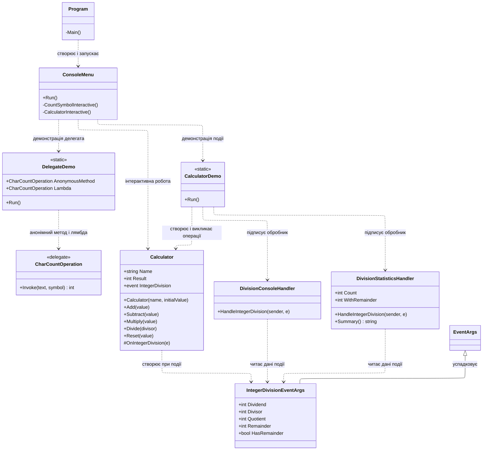
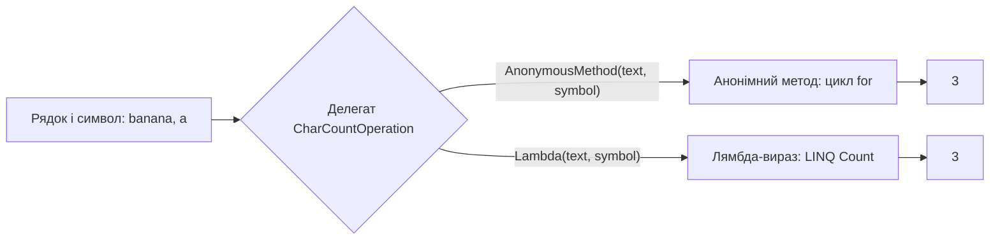
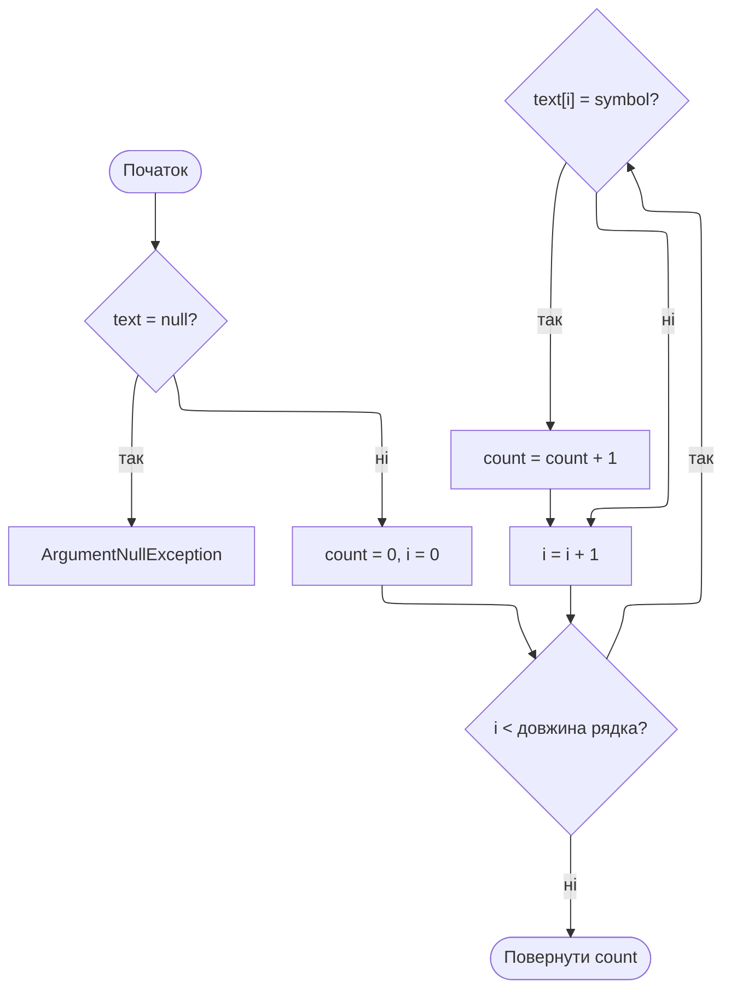
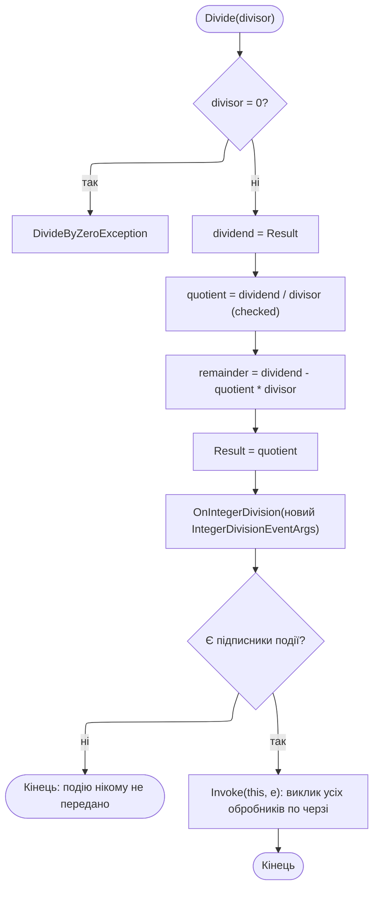
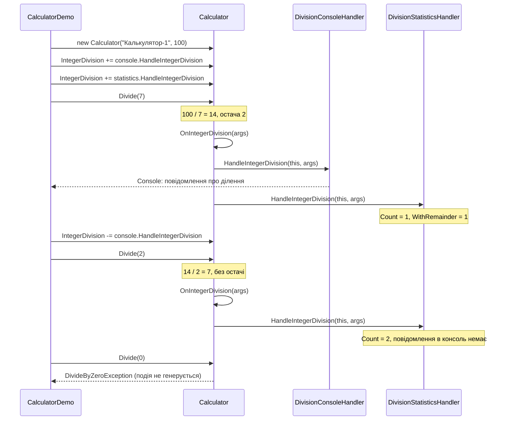

# Схеми до лабораторної роботи 4 - варіант 2

## 1. Діаграма класів

## 2. Частина 1: делегат, анонімний метод і лямбда-вираз

Алгоритм обчислення (анонімний метод):

## 3. Частина 2: метод Divide і генерація події

## 4. Взаємодія об'єктів під час події

